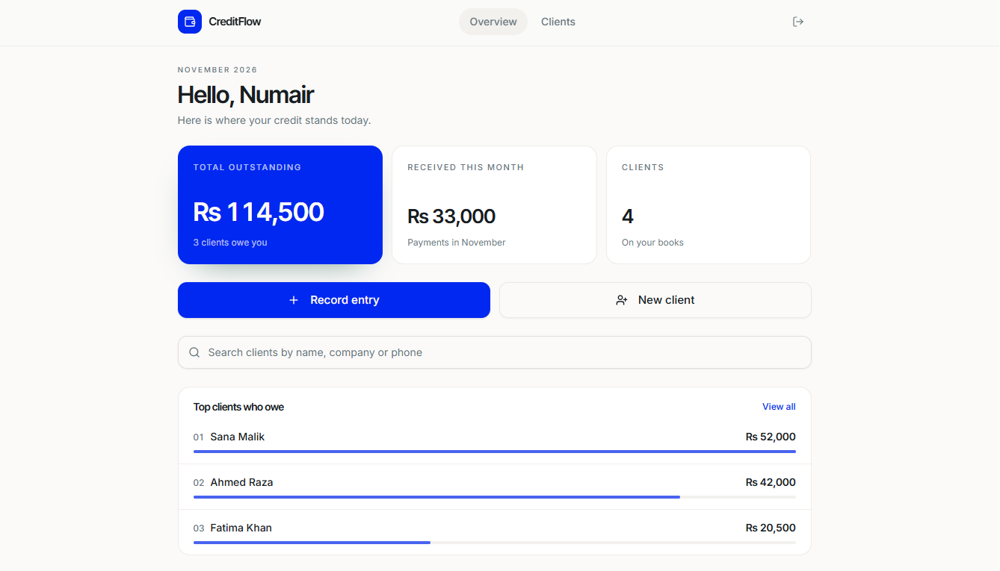
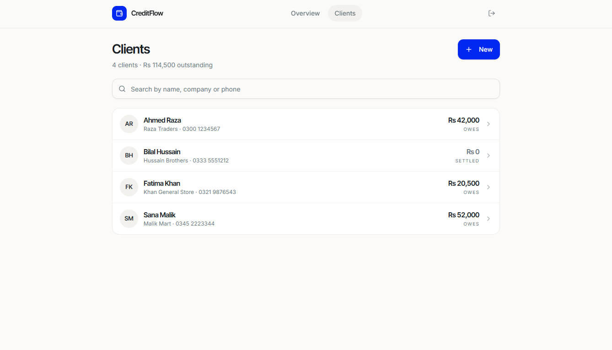
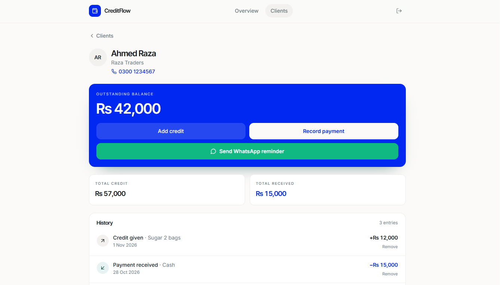

# 💳 CreditFlow

### A Simple Credit Ledger for Small Businesses

Track customer credit (**udhaar**), record payments, and monitor outstanding balances — all in one clean dashboard.

---

## 📌 Overview

**CreditFlow** is a simple credit-ledger web application designed for small business owners, shopkeepers, and freelancers in Pakistan.

Many businesses still track customer credit in paper notebooks or scattered WhatsApp messages. This makes it difficult to know who owes what, how much has been received, and which customers need a payment reminder.

CreditFlow solves this by keeping every client, credit entry, and payment in one place, with a clear dashboard showing the business’s current financial position.

## 🎯 Problem

Small shops and freelancers in Pakistan often manage customer credit manually. This creates common problems:

- 📒 Credit records are kept in paper notebooks
- 💬 Payment details are scattered across chat messages
- ❓ It is difficult to know the exact amount each customer owes
- 📉 Monthly received payments are hard to calculate
- ⏰ Customers with pending balances are easy to forget

## 💡 Solution

CreditFlow provides a simple and organized way to manage customer credit.

- ✅ Store all clients in one place
- ✅ Record credit given and payments received
- ✅ View total outstanding balance instantly
- ✅ Identify clients with the highest pending amounts
- ✅ Keep business data private and secure

## ✨ Features

| Feature | Description |
|---|---|
| 📊 **Dashboard Overview** | View total outstanding amount, payments received this month, and total number of clients |
| 👥 **Client Management** | Add clients with name, company, and phone number |
| 🧾 **Ledger Entries** | Record credit given and payments received for each client |
| 🏆 **Top Clients Who Owe** | Ranked list with progress bars to highlight the largest outstanding balances |
| 🔍 **Smart Search** | Quickly find clients by name, company, or phone number |
| 🔐 **Authentication** | Secure signup and login for each business owner |
| 🛡️ **Data Privacy** | Every client, credit entry, and payment is private to the account that created it |
| 💰 **Currency Support** | All amounts are displayed in Pakistani Rupees (Rs) |

## 🖼️ Screenshots

| Dashboard | Clients |
|---|---|
|  |  |

| Client Detail | Login |
|---|---|
|  |  |

> **Note:** All data shown in the screenshots is sample data for demonstration purposes only.

## 🛠️ Built With

- [Base44](https://base44.com) — AI app builder used to design, generate, and deploy the application

## 🧩 How I Built It

I designed the product idea, defined the core screens, and structured the application data around three main entities:

- **Clients**
- **Ledger Entries**
- **Payments**

The app was built and refined using prompts and manual edits in Base44. I iterated on the user interface, theme, access rules, and overall user experience before testing and publishing the application.

## 🚀 Roadmap

- 📄 Monthly client statements
- 🔔 Payment reminders
- 📤 Export data to spreadsheet
- 📱 Improved mobile experience

## 🌐 Live Demo

Try the application here:

**[CreditFlow Live Demo](https://vivacious-credit-flow-pro.base44.app)**

## 📝 Note

This repository is a **project showcase**.

The application is built and hosted on **Base44**, so the source code is not included in this repository. Please use the live demo link above to explore the application.

## 👤 Author

**Numair Iqbal**  
BS Computer Science Student  
University of Layyah

